# agent-cost-kit

Un plugin Claude Code pour développer par agents en payant 4 à 5 fois moins, sans perdre en qualité de revue. Les choix du kit viennent de mesures sur 109 stories et environ 1 850 $ d'équivalent API ([détail](docs/mesures.md)).



*English summary at the end.*

## Démarrer en 3 commandes

```
/plugin marketplace add Aliquanto3/agent-cost-kit
/plugin install agent-cost-kit@agent-cost-kit
/cost-kit-install
```

`/cost-kit-install` applique, avec votre accord et après un aperçu, les réglages qui économisent (pas d'imbrication d'agents, skills claude.ai désactivés, modèle Haiku 5.5), puis prépare le projet courant. Redémarrez ensuite Claude Code. Détail : [installation et contenu](docs/installation.md).

Pour voir en direct ce que coûte la session, au-dessus du prompt, le mod seul suffit :

```
/plugin install couts-session@agent-cost-kit
```

Le mod exige les mods de code de Claude Code, en accès anticipé : ajoutez `"CLAUDE_CODE_ENABLE_FUNCTION_HOOKS": "1"` au bloc `env` de `~/.claude/settings.json`, puis redémarrez Claude Code. Sans cette variable, la bande ne s'affiche pas, sans message d'erreur. Testé avec Claude Code 2.1.280 et 2.1.306.

## Ce que vous obtenez

| Quoi | Pour quoi faire |
|---|---|
| 4 agents : `dev-story` (Sonnet), `second-avis` (Haiku), `reviewer` (Opus), `lookup` (Haiku) | Coder avec Sonnet, relire avec Haiku puis Opus, chercher avec Haiku. Aucun relecteur ne trouve tout seul. |
| Mod `couts-session` | Coût, tokens, contexte et carbone estimé de la session, par modèle et par sous-agent ([doc](docs/couts-session.md)). |
| `/agent-cost-kit:mesurer-couts` | Le coût réel de chaque agent et de chaque story, relu dans vos transcriptions locales, sans appel d'API ([doc](docs/mesurer-couts.md)). |
| `/agent-cost-kit:avancement-run` | La synthèse d'avancement d'un run autonome BMAD ([doc](docs/avancement-run.md)). |
| `bancs/` | Les protocoles pour refaire les mesures quand de nouveaux modèles sortent ([bancs/README.md](bancs/README.md)). |

## L'enchaînement par story

```
orchestrateur (Opus, medium) → dev-story (Sonnet) → second-avis (Haiku) → reviewer (Opus) → fusion
```

Chaque appel est bloquant, la revue tient en une seule passe, et un sous-agent ne lance jamais d'autre sous-agent.

## Les cinq règles qui comptent

1. **Pas d'agent qui relance des agents.** L'agent intermédiaire pèse 36 à 47 % d'une story.
2. **Garder le cache des sous-agents à 5 min.** Le cache à 1 h coûte 28 à 30 % de plus, et 78 à 86 % des sous-agents n'ont aucune expiration.
3. **Compter les appels et le contexte lu.** Le cache représente environ 80 % du coût ; sur Opus, une story coûte 0,31 à 0,36 $ par million de « pic de contexte × appels ».
4. **Réduire le contexte fixe.** Couper les skills claude.ai retire 8,4 k tokens à chaque agent.
5. **Sonnet pour coder, Opus pour relire, Haiku pour le second avis.** Sur une nuit de 5 stories : 2,36 $ par story en médiane, contre 16,57 $ avec l'ancien setup.

Mesurez votre point de départ avant de changer de méthode : `/agent-cost-kit:mesurer-couts`.

## Pour aller plus loin

- [Les mesures](docs/mesures.md) : corpus, revue, setup mesuré en série, ce qui dépend de votre projet, limites.
- [Mesurer les coûts et l'empreinte](docs/mesurer-couts.md) : le script, les pièges du calcul, EcoLogits, la mise à jour quand de nouveaux modèles sortent.
- [Pièges vus en run autonome](docs/pieges-runs.md) : tests instables sous charge, extension SQLite, push refusé, `python` nu sous Windows.
- [Historique des versions](CHANGELOG.md).

## English summary

A Claude Code plugin for agent-based development at a fraction of the cost. Measured on 3 projects, 109 stories and about $1,850 of API-equivalent spend: cache reads and writes make up about 80 % of the cost, an agent that spawns agents takes 36 to 47 % of a story, and a 1-hour subagent cache costs about 30 % more for most subagents. The kit ships Sonnet for coding, a Haiku second opinion, an Opus reviewer, a Haiku lookup agent, a cost-measurement script that reads local transcripts, and a live cost band above the prompt (`couts-session`). Install with the three commands above. Details are in `docs/` (in French).

## Licence

MIT.
